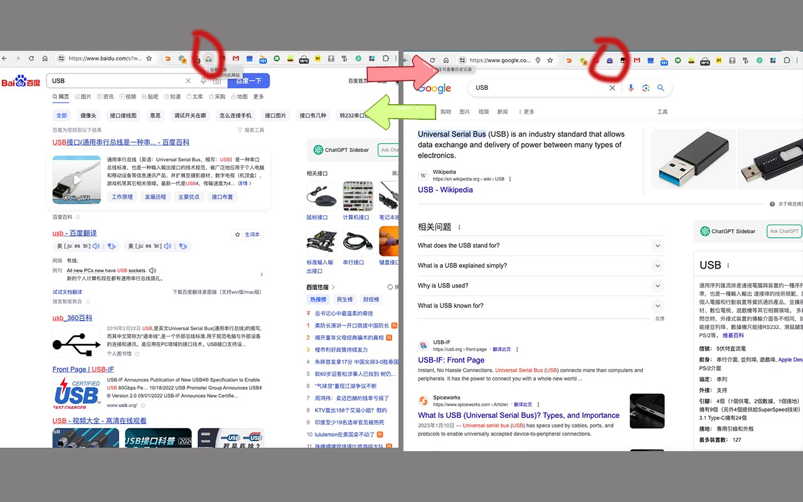

# easy_switch

一个浏览器扩展。网站间的快速切换，保留搜索内容继续搜索。可以通过按钮或者快捷键切换。支持自定义搜索网站。
移植自Chrome同名扩展，原扩展已下架([备份地址](https://www.crx4chrome.com/extensions/fknieppmhfgnjilnkdeoegocjkijpbfh/))。
由于原作者常年未维护，也无法联系。若有侵权，请联系我删除。

## 下载地址

[Chrome 商店](https://chrome.google.com/webstore/detail/pchjdhcdlgghofamcpncdlhdonbeaplk)
，[Firefox Addon](https://addons.mozilla.org/zh-CN/firefox/addon/easy_switch)
，[Edge商店](https://microsoftedge.microsoft.com/addons/detail/jijkhdficgnnikdijnkienfnmfbolmpb)
> 由于本人不用Edge，所以不保证Edge版本可以正常工作，仅保持和另外两个版本代码一致。

Safari 测试版可以从 [Releases](https://github.com/niu541412/easy_switch/releases/latest) 下载。

## 后续计划

1. 改进 Safari 兼容性

## 更新日志

见[Changelog](CHANGELOG.md)。

## 构建与发布

运行 `python3 scripts/build.py` 会生成 `dist/chrome`、`dist/firefox`、`dist/safari` 和对应的 ZIP 包。Chrome 和 Safari 包使用 MV3 service worker；Firefox 包使用后台脚本，并设置现有 AMO 扩展 ID。构建仅包含运行时文件，不包含仓库文档和截图。

提交 PR 时，GitHub Actions 会构建三个包、检查 Firefox 包，并在 macOS runner 上验证 Safari App 构建。发布时先把 `manifest.json` 的版本号更新为新版本，再推送对应标签（例如 `v3.0.6`）；标签与 manifest 版本不一致时，工作流会停止。也可以在 GitHub Actions 页面选择一个已有版本标签，手动运行工作流。

标签构建会在 GitHub Release 附上 Chrome ZIP、Firefox ZIP 和 macOS Safari App ZIP 三个文件。此流程**不向 Chrome Web Store 或 Firefox Add-ons 提交版本**。Chrome 和 Firefox ZIP 是未签名的扩展包，不等同于商店分发的 CRX 或 XPI。

Safari 构建会在 GitHub 的 macOS runner 上把扩展打包成 `Easy Switch.app`（内含 Safari `.appex`），并将 `easy_switch-safari-macos-<版本>.zip` 附加到 GitHub Release。构建不使用签名证书，不需要 Apple 开发者账号；此包仅供开发与测试，不能作为已签名应用上架或常规分发。旧版 v3.0.2 的 Bundle ID 会继续沿用。

在 macOS 上解压后，将 `Easy Switch.app` 移到“应用程序”并运行一次。Safari 设置 > 高级中打开开发菜单，再到 Safari 设置 > 开发者中开启“允许未签名扩展”，最后在“扩展”中启用 Easy Switch。Safari 每次退出后都需要重新开启“允许未签名扩展”。系统可能拦截从网络下载的未签名 App；仅在确认来源可信后通过系统安全设置允许打开。详见 [Apple 的运行说明](https://developer.apple.com/documentation/safariservices/running-your-safari-web-extension)。

Chrome ZIP 可解压后在扩展管理页通过“加载已解压的扩展程序”安装。Firefox ZIP 可用于开发与临时测试；常规 Firefox 安装仍需要 Mozilla 签名的 XPI。Safari App 的安装方法见上文。
